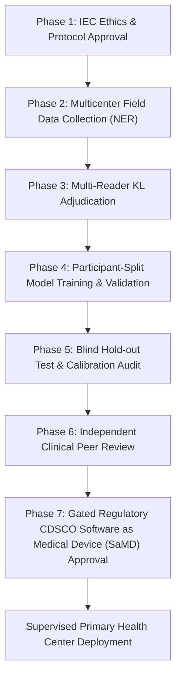

# OA-Sathi: Clinical Model Evaluation & Research Readiness Plan
**Protocol Document Version**: 1.0.0-PROTOTYPE  
**Target Domain**: AI-Assisted Osteoarthritis (OA) Risk Marker Screening for the North Eastern Region (NER), India  
**Scope**: Movement Feature Evaluation, Biomechanical Kinematics, and Responsible Healthcare AI Deployment  

---

## 1. Executive Summary & Clinical Governance Statement

OA-Sathi is currently an **exploratory screening and movement feature prototype**. It provides deterministic, rules-based risk stratification and monocular computer-vision pose estimation (MediaPipe Pose Lite).

> [!IMPORTANT]
> **Current Clinical Status**:
> - **Zero** machine learning models in OA-Sathi are clinically validated for osteoarthritis diagnosis, Kellgren-Lawrence radiographic grading, or triage.
> - **No clinical labels have been invented or fabricated.**
> - **No participant health data or video recordings are transmitted over the cloud.**
> - Exploratory movement indicators (cadence, step symmetry, active knee flexion, coronal trunk sway) are **biomechanical research aids for clinician discussion**, not diagnostic biomarkers.

This document establishes the **formal clinical validation pathway** required before any machine-learning model or automated movement metric can be considered clinically ready for deployment in primary healthcare centers (PHCs) or sub-centers across the North Eastern Region of India.

---

## 2. Ethical Approval, Consent, and Data Governance

Before any training or clinical evaluation data can be captured or analyzed:

1. **Institutional Ethics Committee (IEC) / IRB Approval**:
   - The clinical study protocol must be approved by an authorized Institutional Ethics Committee registered with CDSCO / ICMR (Indian Council of Medical Research).
   - Approval must specifically cover video capture of ambulatory participants, storage of biomechanical coordinates, and clinical/radiological record linkage.
2. **Informed Consent & Cultural Competence**:
   - Multilingual written and audio-recorded informed consent must be obtained in the participant's primary language (Assamese, Bengali, Manipuri, Khasi, Garo, Mizo, Nagamese, Bodo, Hindi, or Nepali).
   - Specific consent must delineate:
     - Questionnaire symptom analysis.
     - Video recording for pose landmark extraction.
     - Permission for de-identified coordinate archiving.
   - Right to withdraw at any point without affecting their standard healthcare.
3. **Data Protection & Privacy**:
   - Compliance with India's **Digital Personal Data Protection Act (DPDPA 2023)** and ICMR Ethical Guidelines for AI in Healthcare.
   - Raw video recordings must be stored on encrypted local physical drives with strict role-based access.
   - De-identification pipeline: 얼굴 (facial blur/anonymization) and extraction of numerical skeletal coordinate vectors only.

---

## 3. Clinically Justified Outcome Definitions

A genuine clinical prediction model requires ground-truth diagnostic reference standards established by qualified rheumatologists and orthopedic specialists:

1. **Primary Radiographic Reference Standard**:
   - **Kellgren-Lawrence (KL) Grading** on standing anteroposterior (AP) and lateral knee radiographs:
     - Grade 0: Normal (no OA).
     - Grade 1: Doubtful joint space narrowing and possible osteophytes.
     - Grade 2: Definite osteophytes and possible joint space narrowing (established clinical cutoff for radiographic OA).
     - Grade 3: Moderate multiple osteophytes, definite joint space narrowing, some sclerosis.
     - Grade 4: Severe large osteophytes, marked joint space narrowing, severe sclerosis.
   - Every training and validation radiograph must be **independently scored by at least two board-certified radiologists/orthopedists**, with consensus adjudication by a third senior reader in cases of inter-rater disagreement (Cohen's $\kappa$ target $\ge 0.85$).
2. **Clinical Reference Standard**:
   - American College of Rheumatology (ACR) Clinical and Laboratory Criteria for Osteoarthritis.
   - Validated patient-reported outcome measures:
     - **WOMAC** (Western Ontario and McMaster Universities Osteoarthritis Index), culturally adapted for NER languages.
     - **KOOS** (Knee Injury and Osteoarthritis Outcome Score).
3. **Target Prediction Tasks**:
   - **Task A (Early Risk Stratification)**: Identifying participants with early symptomatic + radiographic markers (KL $\ge 2$ or WOMAC Pain $> 20$) in community field settings.
   - **Task B (Biomechanical Movement Phenotyping)**: Identifying significant antalgic gait asymmetry or restricted knee excursion correlated with clinician-confirmed functional limitation.

---

## 4. Cohort Selection & Demographic Representation (NER Focus)

Models trained on Western, urban, or gait-laboratory datasets fail when deployed in rural or hilly terrains. The North Eastern Region of India exhibits unique demographic and biomechanical contexts that must be represented:

1. **Target Participant Cohorts**:
   - Community-dwelling adults aged 40+ across diverse terrain zones:
     - **Hilly & Teraced Terrains**: East Khasi Hills (Meghalaya), Kohima (Nagaland), Aizawl (Mizoram) where prolonged uphill/downhill stair climbing and heavy agricultural portage are prevalent.
     - **Valley & Plain Areas**: Kamrup Metropolitan, Dibrugarh (Assam), Imphal West (Manipur).
2. **Subgroup Stratification**:
   - **Sex Representation**: Minimum 50% female participants (given higher postmenopausal OA prevalence).
   - **Footwear Variations**: Barefoot, traditional flat footwear, rubber field boots, and standard athletic shoes (models must be invariant or explicitly calibrated across footwear types).
   - **Terrain & Floor Variations**: Bare earth, wooden floorboards, cement sub-center floors.
   - **Lighting Conditions**: Natural daylight, low indoor tungsten lighting, fluorescent tube lighting.

---

## 5. Dataset Splitting & Prevention of Data Leakage

To ensure scientific validity and avoid over-optimistic evaluation metrics:

1. **Participant-Level Splitting (Strict Partitioning)**:
   - **Zero Patient Leakage**: All recordings, frames, benchmark samples, and questionnaire answers from a given individual must reside strictly in **one** partition:
     - **Training Set (60%)**: Used solely for feature selection and hyperparameter optimization.
     - **Validation Set (20%)**: Used for threshold calibration and model selection.
     - **Hold-out Test Set (20%)**: Held completely blind until final evaluation.
   - Multi-video recordings of the same participant must never be split across train and test sets.
2. **Site-Independent Evaluation (Cross-District Testing)**:
   - The test set must include at least two independent health districts not included in the training cohort to evaluate out-of-distribution generalizability across different clinical facilities and operators.

---

## 6. Comprehensive Statistical Evaluation Metrics

A medical risk prediction model must not be judged solely on overall accuracy, especially under class imbalance:

| Metric | Target Minimum | Clinical Rationale |
|---|---|---|
| **Sensitivity (Recall)** | $\ge 85\%$ | In community screening, minimizing false negatives is critical so symptomatic individuals are not denied clinical consultation. |
| **Specificity** | $\ge 80\%$ | Minimizes unnecessary referrals and health system burden at resource-constrained district hospitals. |
| **AUROC (Area under ROC Curve)** | $\ge 0.85$ | Evaluates discrimination across all decision thresholds. |
| **Precision-Recall AUC (PR-AUC)** | $\ge 0.75$ | Critical metric for evaluating low-to-moderate prevalence populations. |
| **Brier Score Calibration** | $\le 0.12$ | Ensures predicted probabilities match observed event rates (calibration plot slope $\approx 1.0$). |
| **95% Bootstrap Confidence Intervals** | Required ($B = 2,000$ iterations) | Quantifies statistical uncertainty on all reported metrics. |

---

## 7. Subgroup Fairness & Bias Audits

Prior to clinical pilot testing, formal algorithmic fairness audits must be conducted:

1. **Demographic Parity & Equalized Odds**:
   - True Positive Rate (TPR) and False Positive Rate (FPR) parity across:
     - Sex (Male vs Female).
     - Age brackets (40–49, 50–59, 60–69, 70+).
     - Tribal and indigenous community dialects across the 8 NER states.
2. **Technical Parity**:
   - Tracking stability and metric error margins audited across skin tone diversity (Fitzpatrick scale types III–VI), loose traditional clothing (e.g. Mekhela Chador, Jainsem, Puan), and varying ambient light levels (100–1000 lux).

---

## 8. Independent Clinical Validation & Deployment Gating

### Deployment Gating Rules:
- **Gate 1**: Zero models can claim clinical diagnostic efficacy until Phase 6 peer-reviewed clinical trial publication.
- **Gate 2**: Prototype software must visibly display the non-diagnostic disclaimer on every screen.
- **Gate 3**: Clinician-in-the-loop: Software output must always serve as an adjuvant discussion tool, never replacing physical clinical examination by a registered medical practitioner.
